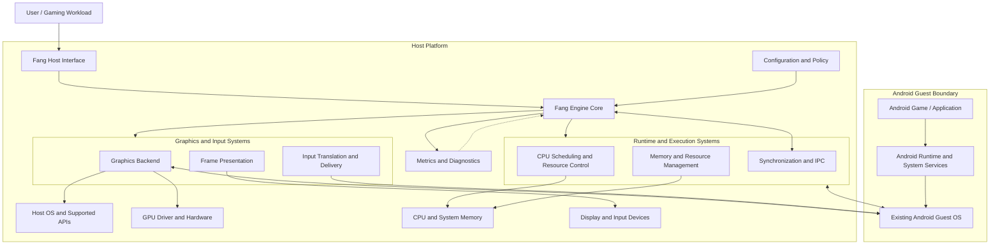

# Project Definition

| Attribute | Detail |
| :--- | :--- |
| **Product** | Custom Windows Android gaming player |
| **Core language** | C++20 |
| **Build system** | CMake |
| **Primary target** | Maximum sustainable gaming FPS |
| **Secondary targets** | GPU efficiency, frame pacing, stability |
| **Development approach** | Modular, measurable, test-driven |


**A custom Android gaming engine focused on maximum FPS, GPU utilization, and low-latency execution.**

Fang is a from-scratch engineering project focused on building a custom engine and supporting systems around an existing, documented Android guest operating system. Its primary objective is to maximize gaming performance while maintaining a clean architecture, measurable performance characteristics, and clear boundaries between the engine and the guest OS.

The project will be developed incrementally, beginning with a documented architecture and a minimal, testable foundation before moving toward Android guest integration and gaming performance optimization.

> **Project status:** Early development / architecture and foundation phase  
> **Primary target:** Gaming performance  
> **Core priorities:** FPS, frame-time consistency, GPU utilization, low latency, and stability

---

## Table of Contents

- [Vision](#vision)
- [Project Goals](#project-goals)
- [Architecture](#architecture)
- [Core Components](#core-components)
- [Design Principles](#design-principles)
- [Performance Metrics](#performance-metrics)
- [Development Roadmap](#development-roadmap)
- [Acceptance Criteria](#acceptance-criteria)
- [Development Environment](#development-environment)
- [Repository Structure](#repository-structure)
- [Building and Testing](#building-and-testing)
- [Current Limitations](#current-limitations)
- [Contributing](#contributing)
- [License](#license)

---

## Vision

The vision behind Fang is to build a purpose-designed Android gaming environment that prioritizes performance rather than relying on a general-purpose implementation without gaming-specific optimization.

Fang will aim to:

- Minimize engine overhead and unnecessary work on the critical rendering path.
- Maximize effective GPU utilization when the workload and hardware permit it.
- Reduce CPU scheduling overhead, input latency, and frame delivery delays.
- Maintain stable frame pacing instead of optimizing only average FPS.
- Use hardware acceleration and supported graphics interfaces wherever possible.
- Establish explicit interfaces between the custom engine and the Android guest OS.
- Measure every meaningful optimization against a reproducible baseline.

Fang is a long-term engineering project. Performance improvements will be demonstrated through measurements rather than assumed from architectural choices alone.

## Project Goals

### Primary goals

1. **High gaming performance** — optimize CPU and GPU workloads, rendering throughput, and frame delivery.
2. **Low latency** — reduce avoidable delays across input, processing, rendering, and display presentation.
3. **Efficient resource management** — manage CPU time, memory, graphics resources, and I/O overhead.
4. **Android guest integration** — establish a documented, testable interface with the selected Android guest OS.
5. **Performance observability** — provide metrics and diagnostic information to identify bottlenecks.
6. **Maintainable architecture** — keep components modular, independently testable, and replaceable.

### Non-goals for the initial milestone

- Claiming compatibility with every Android game.
- Promising native or near-native performance before benchmarking.
- Rewriting the Android operating system itself.
- Implementing a custom hypervisor or kernel before the selected execution model requires one.
- Introducing unsupported GPU drivers or undocumented hardware interfaces.
- Adding complex features before the minimal architecture has been validated.

---

## Architecture

Fang separates its engine control systems, guest OS integration, graphics execution, and host hardware interfaces. The exact execution model and graphics backend will be selected after the development environment and target hardware are evaluated.



*Conceptual architecture: component connections represent intended responsibilities, not verified implementations or guaranteed direct access to guest internals.*

### Architectural boundaries

**Host platform:** Provides the operating system, hardware access, device drivers, and supported system APIs.

**Fang engine:** Owns orchestration, configuration, resource policies, performance instrumentation, and coordination of the selected execution model.

**Graphics and input:** Handles the chosen rendering or graphics integration path, frame presentation, input delivery, and relevant synchronization.

**Android guest:** Runs the existing Android OS and its applications. Guest internals will be modified only when required and supported by the chosen integration model.

**Hardware:** Executes workloads through supported CPU and GPU interfaces. Direct hardware access is not assumed.

The final implementation may differ from this diagram after technical feasibility testing.

---

## Core Components

| Component | Responsibility |
|---|---|
| Engine Core | Lifecycle, initialization, component coordination, and shutdown |
| Guest Integration | Guest startup, health checks, communication, and lifecycle management |
| Graphics Backend | Graphics API integration, resource handling, and rendering coordination |
| Frame Pacing | Frame timing, presentation scheduling, and latency measurement |
| Resource Manager | CPU, memory, and graphics resource accounting |
| Input Pipeline | Input capture, translation, and delivery |
| Performance Monitor | FPS, frame times, CPU/GPU metrics where available, and diagnostic logs |
| Configuration System | Runtime settings, feature flags, and reproducible test configurations |
| Test Infrastructure | Unit tests, integration tests, and performance regression tests |

These are planned responsibilities. Components should be introduced when their interfaces and implementation requirements are established.

---

## Design Principles

### 1. Measure before optimizing

Every performance change should have a baseline, a reproducible workload, and a measurable outcome.

### 2. Preserve modularity

Guest management, rendering, input, scheduling, and telemetry should communicate through explicit interfaces.

### 3. Minimize critical-path overhead

Avoid unnecessary allocations, blocking operations, redundant copies, and excessive synchronization in performance-sensitive paths.

### 4. Respect hardware and OS constraints

GPU scheduling, driver behavior, memory access, and system-level resource controls are subject to the capabilities and permissions of the host platform.

### 5. Keep guest and engine responsibilities separate

Fang should not depend on undocumented guest implementation details when a stable interface is available.

### 6. Prefer verified improvements

Optimizations must preserve correctness and stability. Higher average FPS is not sufficient if frame pacing, latency, or reliability deteriorates significantly.

---

## Performance Metrics

Fang will evaluate performance using a consistent benchmark methodology.

| Metric | Purpose |
|---|---|
| Average FPS | Overall rendering throughput |
| 1% low FPS | Performance during slower frames |
| Frame-time distribution | Consistency and delivery of frames |
| CPU utilization | CPU workload and potential bottlenecks |
| GPU utilization | GPU workload, where reliable telemetry is available |
| Input-to-display latency | Responsiveness of the input pipeline |
| Memory usage | RAM and graphics memory consumption |
| Thermal behavior | Sustained performance under extended workloads |
| Stability | Crashes, hangs, guest failures, and rendering errors |

Performance results should record the hardware, OS version, guest configuration, graphics backend, game or test workload, test duration, and measurement method.

Fang will not promise a particular FPS target until a baseline and target hardware configuration have been established.

The first-party [Android GLES probe](docs/android-gles-probe.md) provides a repeatable renderer microbenchmark for reference-path comparisons. It is not a game workload or a product FPS result.

See [Performance Evidence and Phase 9 Gate](docs/performance-validation.md) for the separate host-timing, synthetic GLES, and real-workload measurement contracts and evidence-transfer rules.

---

## Development Roadmap

### Phase 0 — Environment and foundation

- [x] Inspect the Windows host, hardware, compiler, CMake, and SDK.
- [x] Establish Debug and Release CMake builds and repeatable PowerShell scripts.
- [ ] Verify reproduction from a clean checkout.

### Phase 1 — Host timing benchmark

- [x] Implement monotonic QPC interval and wake-lateness measurements.
- [x] Add validated arguments, raw JSON samples, metadata, and summary statistics.
- [x] Test argument validation and statistics; run repeated host-only trials.

### Phase 2 — Core services

- [x] Add versioned configuration parsing, typed errors, and structured logging.
- [x] Add service lifecycle ownership, rollback, shutdown error reporting, and capability states.
- [x] Verify deterministic and concurrent lifecycle behavior in Debug and Release.

### Phase 3 — Windows development shell

- [x] Build a native Win32 shell connected to the real core service host and logger.
- [x] Smoke-test Start/Stop state, visible logs, and clean shutdown.
- [x] Add repeatable automated GUI interaction tests.

### Phase 4 — Runtime and guest architecture decisions

- [x] Evaluate Android Emulator, QEMU+WHPX, and direct WHP options; see the proposed ADR.
- [ ] Select and document an Android guest, execution model, graphics integration, security boundary, and licensing constraints.
- [ ] Review and approve the architecture decision before substantial runtime implementation.

### Phase 5 — Execution and memory

- [ ] Implement only the minimum execution and memory functions required by the approved architecture.

### Phase 6 — Guest boot and devices

- [ ] Boot a real Android guest and verify required device paths.

### Phase 7 — Graphics and display

- [ ] Render the actual guest display and verify the host presentation path.

### Phase 8 — Input and audio

- [ ] Verify real guest input delivery and audio transport.

### Phase 9 — Gaming compatibility and benchmarking

**Status: BLOCKED.** The first-party animated GLES workload was implemented and locally exercised under separate authorization for graphics-path and instrumentation validation only. It is not a representative game workload, a product guest path, or Phase 9 evidence. See the [runtime readiness audit](docs/runtime-readiness-audit.md) and [performance evidence gate](docs/performance-validation.md).

- [ ] Establish repeatable real-application workloads and record FPS/frame-time evidence.
- [ ] Pass the evidence gate in [Performance Evidence and Phase 9 Gate](docs/performance-validation.md) before claiming product performance.

### Phase 10 — Optimization

**Status: NOT STARTED.** Do not optimize from host-timer or synthetic GLES results; require an approved Phase 9 baseline and evidence-backed bottleneck first.

- [ ] Profile bottlenecks and retain only reproducible, correctness-preserving improvements.

### Phase 11 — Production readiness

- [ ] Audit security, licensing, packaging, compatibility, privacy, and release reproducibility.

---

## Acceptance Criteria

The project should advance through measurable milestones.

**Initial milestone — buildable foundation**

- The repository contains a documented architecture and defined implementation scope.
- A clean checkout can be configured and built using documented instructions.
- The minimal engine starts, reports its version, and exits cleanly.
- Logging and configuration work.
- Automated tests execute and report their results.
- Guest and graphics interfaces are documented, even if their implementations are initially placeholders.
- No unimplemented functionality is represented as production-ready.

**Guest integration milestone**

- The selected guest OS starts and stops through the documented integration path.
- Guest health and lifecycle failures can be detected.
- Basic application launch and input delivery are verified.
- Integration overhead can be measured.

**Performance milestone**

- A reproducible benchmark workload and baseline exist.
- FPS and frame-time measurements are recorded consistently.
- CPU/GPU bottlenecks are investigated using available telemetry.
- Optimization results are compared against the baseline.
- Stability and correctness remain within documented acceptance limits.

---

## Development Environment

The exact development environment has not yet been finalized.

The following must be documented before the first functional engine milestone:

- **Host OS:** To be selected.
- **CPU and GPU:** Target hardware to be identified.
- **Android guest OS:** Existing documented guest distribution and version to be identified.
- **Language:** To be selected based on performance, platform integration, and maintainability.
- **Build system:** To be selected with reproducible builds in mind.
- **Graphics backend:** To be selected after API and driver capability testing.
- **Testing:** Automated unit tests, integration tests, and benchmark workloads.

Avoid committing machine-specific paths, credentials, generated build directories, or unlicensed guest OS images.

---

## Repository Structure

Proposed initial layout:

```text
Fang/
├── README.md
├── LICENSE
├── .gitignore
├── docs/
│   ├── architecture.md
│   ├── development-setup.md
│   ├── guest-integration.md
│   └── performance-benchmarking.md
├── src/
│   ├── core/
│   ├── guest/
│   ├── graphics/
│   ├── input/
│   ├── resources/
│   └── telemetry/
├── tests/
│   ├── unit/
│   ├── integration/
│   └── benchmarks/
├── scripts/
└── third_party/
```

This is a proposed structure, not a claim that all directories or components already exist. Create directories as their implementation becomes necessary.

---

## Building and Testing

The current Phase 0/1 build uses C++20, CMake, MSVC, and the Windows SDK. See [the Windows development setup](docs/development-setup.md) for prerequisites and [the host timing benchmark notes](docs/host-timing-benchmark.md) for measurement semantics.

From a Visual Studio 2026 Build Tools installation with the C++ workload and Windows 11 SDK:

```powershell
Set-ExecutionPolicy -Scope Process -ExecutionPolicy RemoteSigned
./scripts/build.ps1 -Configuration Debug
./scripts/test.ps1 -Configuration Debug
./scripts/build.ps1 -Configuration Release
./scripts/test.ps1 -Configuration Release
./scripts/benchmark.ps1 -DurationMs 1000 -IntervalUs 1000 -Runs 3
```

The benchmark writes JSON with raw samples under `out/benchmarks/` by default. It measures Windows host timer wakeups only; it is not an Android, gaming FPS, GPU throughput, or input-to-photon benchmark.

Phase 2 adds the platform-independent `fang_core` library for versioned configuration parsing, structured logging, typed errors, and ordered service lifecycle management. See [the Phase 2 core services notes](docs/phase2-core-services.md) for contracts and remaining limits.

The optional `fang-studio` Windows application exposes the core-service lifecycle and a local Android Player mode. It can launch and monitor an installed Android Emulator AVD in the Emulator's own standalone window; it does not embed the guest display, verify Android boot completion, or provide a Fang product guest/graphics backend. Android Studio is not launched by Fang for this path. See the [runtime readiness audit](docs/runtime-readiness-audit.md).

---

## Current Limitations

Fang is in its early development phase. At this stage:

- Gaming performance has not been benchmarked.
- Fang's product Android guest integration has not been selected or validated. Local reference-AVD launch support is not product-runtime evidence.
- Graphics backend selection is pending feasibility testing.
- Hardware compatibility has not been established.
- No FPS, latency, or GPU utilization improvement is guaranteed.
- The architecture may evolve as implementation constraints become clear.

These limitations will be updated as milestones are completed and verified.

---

## Contributing

Contributions should follow the project's engineering principles:

- Keep changes focused and reviewable.
- Document architectural decisions.
- Add tests for new behavior.
- Provide benchmark evidence for performance-related changes.
- Avoid introducing unnecessary dependencies.
- Document platform requirements and known limitations.
- Do not commit secrets, proprietary binaries, or third-party assets without appropriate permission.

Development guidelines and contribution procedures will be expanded as the project matures.

---

## License

The project's license has not yet been selected.

Before distributing source code publicly, choose an appropriate license and add the corresponding `LICENSE` file. Until then, do not assume that other users have permission to redistribute or reuse the project.
