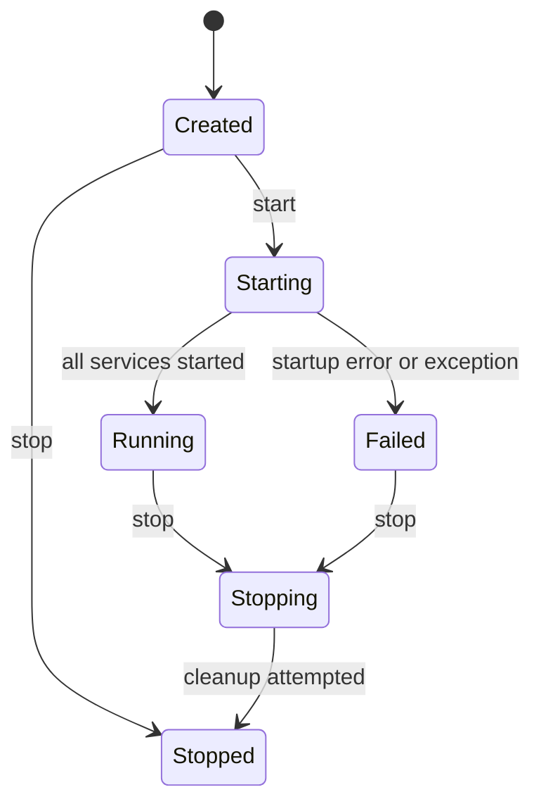

# Phase 2 Core Services

## Scope and ownership

`fang_core` is a C++20 library with no third-party dependencies. It is separate from the host timing executable and contains no Windows API calls. The host timing benchmark remains a Windows/MSVC target. No Android guest, runtime, graphics, input, audio, UI, or virtualization code is implemented here.

## Configuration

`CoreConfig` supplies schema version 1 and an `info` minimum log level by default. `load_configuration(std::istream&)` parses a strict, flat UTF-8 key/value format:

```text
schema_version = 1
logging.level = info
```

Blank lines and full-line `#` or `;` comments are accepted. Supported keys are required `schema_version` and optional `logging.level` (`trace`, `debug`, `info`, `warning`, or `error`). Duplicate and unknown keys, malformed values, missing versions, and unsupported versions return typed errors. Parsing does not access the filesystem; callers own file opening, persistence, and atomic replacement. There is no legacy version to migrate yet.

## Errors and logging

`CoreError` carries a stable `ErrorCode`, human-readable message, and context. `Result<T>` and `Result<void>` propagate expected failures without using exceptions as routine control flow; exceptions from service initialization are caught and translated by `ServiceHost`.

`Logger` writes one JSON record per line with Unix-epoch milliseconds, severity, stable code, context, and message. It filters below its configured minimum level, escapes JSON control characters, serializes concurrent writes, and returns `LogWriteFailed` if its borrowed output stream fails. The stream must outlive the logger. The logger does not choose a global sink, flush every record, rotate files, or claim asynchronous/non-blocking behavior. Callers must validate configuration and select a sink explicitly.

Callers must provide valid UTF-8 in log code, context, and message fields; the logger escapes JSON syntax/control characters but does not validate or normalize arbitrary byte sequences.

## Capability reporting

`CapabilityRegistry` distinguishes `Unavailable`, `Detected`, `Initialized`, and `Verified`. A capability must be defined before updates, and upward reports can advance only one stage at a time; a caller cannot label a merely detected adapter as a verified guest-rendering path. Same-stage evidence may be refreshed, and downgrades are allowed when a device is lost or verification becomes stale. Each report carries caller-supplied evidence text. The registry does not probe hardware or independently validate that evidence; future platform/runtime code owns those observations.

## Lifecycle and shutdown

The host state machine is:



Services are uniquely owned by `ServiceHost`, registered only in `Created`, started in registration order, and stopped in reverse order. If startup fails or throws, the failing service receives a cleanup attempt first, then previously started services are unwound in reverse order. During normal shutdown, every started service is asked to stop even if an earlier shutdown fails; the first error is returned and the host reaches `Stopped`. Repeated stop is idempotent. The destructor makes a best-effort stop, but callers should call `stop()` explicitly to observe shutdown errors.

Lifecycle operations are serialized. `state()` remains queryable during callbacks, but service callbacks must not recursively call mutating `ServiceHost` methods. `IService::stop()` should release owned resources and report failures; service implementations remain responsible for RAII cleanup of partially acquired resources if their own cleanup fails.

## Verification

The core unit target covers default and parsed configuration, malformed/duplicate/unknown/unsupported configuration, capability declaration and staged reporting, log filtering and JSON escaping, concurrent log writes, logger sink errors, lifecycle transitions, duplicate registration, ordered shutdown, shutdown error reporting, startup rollback, exception translation, and concurrent start/stop serialization. CTest reports the host timing tests separately from the core suite.

## Deferred work

- Persistent configuration file selection, atomic save, and migration once a prior schema exists.
- Concrete logging sinks, retention, diagnostics export, and host integration.
- Core initialization wiring with real runtime/platform services.
- Guest architecture and host/guest protocol; these must follow the Phase 4 decision.